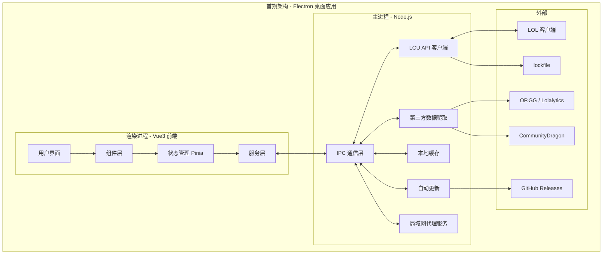
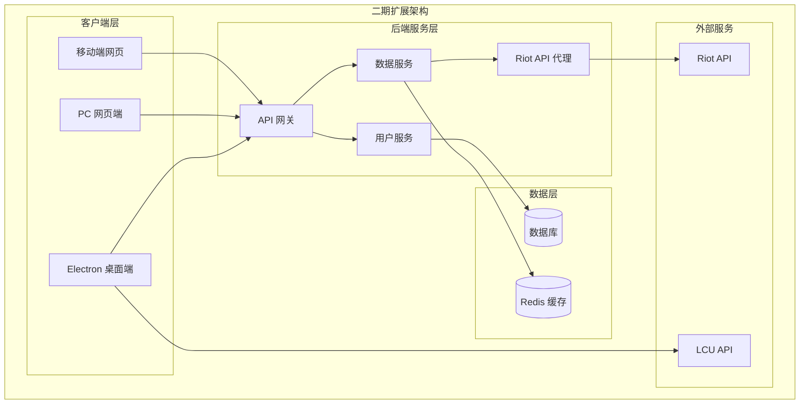
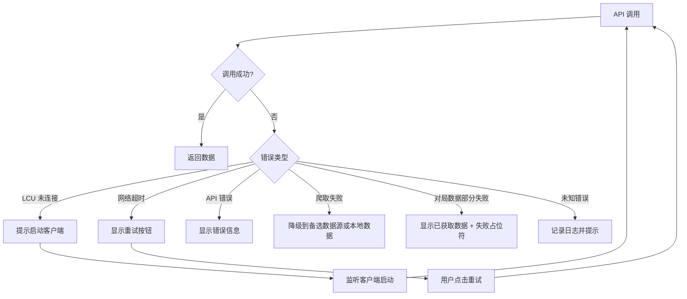

# 英雄联盟助手工具 - 技术设计文档

Feature Name: lol-assistant-tool
Updated: 2026-03-03

## 概述

本文档描述英雄联盟助手工具的技术架构设计。首期采用 Electron + Vue3 架构，通过 LCU API 连接英雄联盟客户端，提供战绩查询、排位信息等功能。架构设计充分考虑后续扩展需求，预留后端服务、多平台适配等接口。

---

## 架构概览

### 整体架构图



### 二期扩展架构



---

## 首期架构详细设计

### 1. Electron 主进程设计

主进程负责系统级操作和与 LCU API 的通信。

```typescript
// 主进程模块结构
src/main/
├── index.ts                 # 入口文件
├── ipc/                     # IPC 通信模块
│   ├── index.ts            # IPC 处理器注册
│   ├── summoner.ts         # 召唤师相关
│   ├── match.ts            # 战绩相关
│   ├── rank.ts             # 排位相关
│   └── live-game.ts        # 对局实时分析
├── lcu/                     # LCU API 模块
│   ├── client.ts           # LCU 客户端连接
│   ├── lockfile.ts         # lockfile 解析
│   ├── websocket.ts        # LCU WebSocket 订阅
│   └── api.ts              # API 封装
├── scraper/                 # 第三方数据爬取模块
│   ├── index.ts            # 爬取器统一接口
│   ├── opgg.ts             # OP.GG 数据爬取
│   ├── lolalytics.ts       # Lolalytics 数据爬取（备选）
│   ├── storage.ts          # 爬取数据分片存储
│   ├── types.ts            # 爬取数据类型定义
│   └── scheduler.ts        # 定时更新调度器
├── cache/                   # 缓存模块
│   └── store.ts            # 本地存储
├── proxy/                   # 局域网代理（可选）
│   └── server.ts           # 代理服务器
├── updater/                 # 自动更新模块
│   └── index.ts            # electron-updater 封装
└── utils/                   # 工具函数
    ├── process.ts           # 进程检测
    └── logger.ts            # 日志（electron-log）
```

#### 1.1 LCU 连接模块

```typescript
// lcu/client.ts - 核心接口定义

interface LCUCredentials {
  port: number;
  password: string;
  protocol: 'https';
}

interface LCUClient {
  // 连接管理
  connect(): Promise<void>;
  disconnect(): void;
  isConnected(): boolean;

  // 事件订阅
  on(event: 'connected', handler: () => void): void;
  on(event: 'disconnected', handler: () => void): void;

  // WebSocket 订阅（用于选人助手等实时功能）
  subscribe(uri: string, handler: (data: unknown) => void): void;
  unsubscribe(uri: string): void;

  // API 调用
  request<T>(method: string, endpoint: string, data?: unknown): Promise<T>;
}
```

#### 1.2 Lockfile 解析与进程检测

```typescript
// lcu/lockfile.ts

interface LockfileData {
  name: string;      // 通常是 "LeagueClient"
  pid: number;       // 客户端进程 ID
  port: number;      // LCU API 端口
  password: string;  // 认证密码
  protocol: string;  // 通常是 "HTTPS"
}

// 首选方案：通过进程命令行参数动态获取安装路径
// 读取 LeagueClientUx.exe 的 --install-directory 参数，拼接 /lockfile
// 备选方案：静态路径列表
const LOCKFILE_FALLBACK_PATHS = [
  path.resolve(process.env.LOCALAPPDATA, 'Riot Games/League of Legends/lockfile'),
  path.resolve('C:/Riot Games/League of Legends/lockfile'),
  path.resolve('D:/Riot Games/League of Legends/lockfile'),
];
```

#### 1.3 LCU WebSocket 设计

LCU 客户端提供 WebSocket 接口，用于订阅客户端事件（如选人阶段变化、游戏状态变化）。

```typescript
// lcu/websocket.ts

interface LCUWebSocket {
  // 连接到 LCU WebSocket (wss://127.0.0.1:{port})
  connect(credentials: LCUCredentials): Promise<void>;
  disconnect(): void;

  // 订阅特定事件
  subscribe(uri: string, handler: (event: LCUEvent) => void): void;
  unsubscribe(uri: string): void;
}

interface LCUEvent {
  uri: string;
  eventType: 'Create' | 'Update' | 'Delete';
  data: unknown;
}

// 轮询检测配置（客户端启动前）
const POLL_CONFIG = {
  interval: 3000,       // 每 3 秒检测一次进程
  maxRetries: Infinity, // 持续检测直到连接
};
```

#### 1.4 IPC 通信设计

```typescript
// IPC 通道定义
const IPC_CHANNELS = {
  // 连接状态
  'lcu:connect': () => Promise<void>,
  'lcu:disconnect': () => void,
  'lcu:status': () => Promise<ConnectionStatus>,

  // 召唤师
  'summoner:getCurrent': () => Promise<Summoner>,
  'summoner:getById': (puuid: string) => Promise<Summoner>,

  // 战绩
  'match:getList': (params: MatchListParams) => Promise<MatchList>,
  'match:getDetail': (gameId: number) => Promise<MatchDetail>,

  // 排位
  'rank:getStats': (puuid: string) => Promise<RankStats>,

  // 缓存
  'cache:clear': () => Promise<void>,
  'cache:getStats': () => Promise<CacheStats>,

  // WebSocket 事件转发
  'lcu:subscribe': (uri: string) => void,
  'lcu:unsubscribe': (uri: string) => void,
  // 主进程 -> 渲染进程的事件推送通过 webContents.send

  // 对局实时分析
  'live-game:analyze': () => Promise<LiveGameAnalysis>,

  // 第三方数据
  'scraper:getChampionBuilds': (championId: number) => Promise<ChampionBuilds>,
  'scraper:getChampionCounters': (championId: number) => Promise<ChampionCounters>,
  'scraper:updateData': () => Promise<void>,
  'scraper:getDataVersion': () => Promise<ScraperDataVersion>,

  // 窗口管理
  'window:setAlwaysOnTop': (flag: boolean) => void,
  'window:setMiniMode': (flag: boolean) => void,
  'window:minimize-to-tray': () => void,

  // 自动更新
  'updater:checkForUpdates': () => Promise<UpdateInfo | null>,
  'updater:downloadUpdate': () => void,
  'updater:installUpdate': () => void,

  // 日志
  'log:export': () => Promise<string>,  // 返回日志文件路径

  // 首次引导
  'app:isFirstLaunch': () => Promise<boolean>,
  'app:setFirstLaunchDone': () => Promise<void>,
} as const;
```

### 2. Preload 脚本设计

```typescript
// preload/index.ts - 安全桥接主进程和渲染进程

import { contextBridge, ipcRenderer } from 'electron';

// 暴露给渲染进程的 API
contextBridge.exposeInMainWorld('electronAPI', {
  // LCU 连接
  lcuConnect: () => ipcRenderer.invoke('lcu:connect'),
  lcuDisconnect: () => ipcRenderer.invoke('lcu:disconnect'),
  lcuGetStatus: () => ipcRenderer.invoke('lcu:status'),

  // 召唤师
  getCurrentSummoner: () => ipcRenderer.invoke('summoner:getCurrent'),
  getSummonerById: (puuid: string) => ipcRenderer.invoke('summoner:getById', puuid),

  // 战绩
  getMatchList: (params: object) => ipcRenderer.invoke('match:getList', params),
  getMatchDetail: (gameId: number) => ipcRenderer.invoke('match:getDetail', gameId),

  // 排位
  getRankStats: (puuid: string) => ipcRenderer.invoke('rank:getStats', puuid),

  // 缓存
  clearCache: () => ipcRenderer.invoke('cache:clear'),
  getCacheStats: () => ipcRenderer.invoke('cache:getStats'),

  // WebSocket 事件监听
  lcuSubscribe: (uri: string) => ipcRenderer.send('lcu:subscribe', uri),
  lcuUnsubscribe: (uri: string) => ipcRenderer.send('lcu:unsubscribe', uri),
  onLCUEvent: (callback: (event: unknown) => void) => {
    ipcRenderer.on('lcu:event', (_event, data) => callback(data));
    return () => ipcRenderer.removeAllListeners('lcu:event');
  },

  // 通用事件监听
  onConnectionChange: (callback: (status: string) => void) => {
    ipcRenderer.on('lcu:connection-change', (_event, status) => callback(status));
    return () => ipcRenderer.removeAllListeners('lcu:connection-change');
  },

  // 对局实时分析
  analyzeLiveGame: () => ipcRenderer.invoke('live-game:analyze'),

  // 第三方数据
  getChampionBuilds: (championId: number) => ipcRenderer.invoke('scraper:getChampionBuilds', championId),
  getChampionCounters: (championId: number) => ipcRenderer.invoke('scraper:getChampionCounters', championId),
  updateScraperData: () => ipcRenderer.invoke('scraper:updateData'),
  getScraperDataVersion: () => ipcRenderer.invoke('scraper:getDataVersion'),

  // 窗口管理
  setAlwaysOnTop: (flag: boolean) => ipcRenderer.send('window:setAlwaysOnTop', flag),
  setMiniMode: (flag: boolean) => ipcRenderer.send('window:setMiniMode', flag),
  minimizeToTray: () => ipcRenderer.send('window:minimize-to-tray'),

  // 自动更新
  checkForUpdates: () => ipcRenderer.invoke('updater:checkForUpdates'),
  downloadUpdate: () => ipcRenderer.send('updater:downloadUpdate'),
  installUpdate: () => ipcRenderer.send('updater:installUpdate'),
  onUpdateProgress: (callback: (progress: number) => void) => {
    ipcRenderer.on('updater:progress', (_event, progress) => callback(progress));
    return () => ipcRenderer.removeAllListeners('updater:progress');
  },

  // 日志
  exportLog: () => ipcRenderer.invoke('log:export'),

  // 通知事件（主进程 -> 渲染进程）
  onGamePhaseChange: (callback: (phase: string) => void) => {
    ipcRenderer.on('game:phase-change', (_event, phase) => callback(phase));
    return () => ipcRenderer.removeAllListeners('game:phase-change');
  },

  // 首次引导
  getIsFirstLaunch: () => ipcRenderer.invoke('app:isFirstLaunch'),
  setFirstLaunchDone: () => ipcRenderer.invoke('app:setFirstLaunchDone'),
});
```

### 3. 渲染进程设计（Vue3 前端）

```typescript
// 前端目录结构
src/renderer/
├── index.html
├── src/
│   ├── main.ts              # 入口文件
│   ├── App.vue              # 根组件
│   ├── api/                 # API 调用层
│   │   ├── index.ts        # API 统一导出
│   │   ├── lcu.ts          # LCU API 封装（IPC 调用）
│   │   └── types.ts        # 类型定义
│   ├── components/          # 通用组件
│   │   ├── common/         # 基础组件
│   │   ├── summoner/       # 召唤师相关组件
│   │   ├── match/          # 战绩相关组件
│   │   └── rank/           # 排位相关组件
│   ├── views/               # 页面组件
│   │   ├── Home.vue        # 首页
│   │   ├── MatchHistory.vue # 战绩页
│   │   ├── Rank.vue        # 排位页
│   │   ├── ChampionStats.vue # 英雄统计页
│   │   ├── LiveGame.vue    # 对局实时分析页
│   │   ├── DraftAssistant.vue # 选人助手页
│   │   └── Settings.vue    # 设置页
│   ├── stores/              # Pinia 状态管理
│   │   ├── index.ts
│   │   ├── summoner.ts     # 召唤师状态
│   │   ├── match.ts        # 战绩状态
│   │   ├── live-game.ts    # 对局实时分析状态
│   │   └── app.ts          # 应用状态
│   ├── router/              # 路由配置
│   │   └── index.ts
│   ├── composables/         # 组合式函数
│   │   ├── useLCU.ts       # LCU 连接
│   │   └── useCache.ts     # 缓存
│   ├── styles/              # 样式文件
│   └── utils/               # 工具函数
└── env.d.ts                 # 环境变量类型声明
```

#### 3.1 API 层设计（预留扩展）

```typescript
// api/index.ts - 统一 API 接口

// API 提供者接口（便于后续切换数据源）
interface IAPIProvider {
  // 召唤师
  getCurrentSummoner(): Promise<Summoner>;
  getSummonerByPUUID(puuid: string): Promise<Summoner>;

  // 战绩
  getMatchList(params: MatchListParams): Promise<MatchList>;
  getMatchDetail(gameId: string): Promise<MatchDetail>;

  // 排位
  getRankStats(puuid: string): Promise<RankStats>;

  // 英雄统计
  getChampionStats(puuid: string): Promise<ChampionStats[]>;

  // 对局实时分析
  getLiveGameAnalysis(): Promise<LiveGameAnalysis>;

  // 查询对局中其他玩家的战绩（通过 PUUID，仅限当前对局中的玩家）
  getMatchListByPUUID(puuid: string, params: MatchListParams): Promise<MatchList>;
}

// 首期：LCU API 提供者
class LCUAPIProvider implements IAPIProvider {
  // 通过 IPC 调用主进程的 LCU API
}

// 二期扩展：Riot API 提供者
class RiotAPIProvider implements IAPIProvider {
  // 通过后端代理调用 Riot API
}

// API 工厂
function createAPIProvider(type: 'lcu' | 'riot' = 'lcu'): IAPIProvider {
  switch (type) {
    case 'lcu':
      return new LCUAPIProvider();
    case 'riot':
      return new RiotAPIProvider();
  }
}
```

#### 3.2 对局实时分析数据模型与获取流程

```typescript
interface LiveGameAnalysis {
  gameId: number;
  gameMode: string;
  teams: LiveGameTeam[];
}

interface LiveGameTeam {
  teamId: number;
  players: LiveGamePlayer[];
}

interface LiveGamePlayer {
  puuid: string;
  summonerName: string;
  championId: number;
  championName: string;
  // 段位信息
  tier: string;
  division: string;
  leaguePoints: number;
  // 该英雄数据
  championWinRate: number;      // 该英雄胜率
  championGamesPlayed: number;  // 该英雄使用场次
  championMasteryLevel: number; // 熟练度等级
  // 近期表现
  recentWinRate: number;        // 近 10 场胜率
  recentKDA: number;            // 近 10 场 KDA
  // 数据加载状态
  dataStatus: 'loaded' | 'loading' | 'failed';
}
```

**10 人数据获取流程（主进程 live-game IPC 处理器）：**

```
1. 通过 /lol-gameflow/v1/session 获取当前对局 session
   -> 提取 10 人的 summonerId、puuid、championId、teamId

2. 并发请求每位玩家数据（Promise.allSettled 容错）：
   a. 段位: GET /lol-ranked/v1/ranked-stats/{puuid}
   b. 英雄熟练度: GET /lol-collections/v1/inventories/{summonerId}/champion-mastery
   c. 近期战绩: GET /lol-match-history/v1/products/lol/{puuid}/matches?begIndex=0&endIndex=10

3. 聚合数据为 LiveGameAnalysis 结构返回

注意事项：
- 使用 Promise.allSettled 而非 Promise.all，单个玩家查询失败不影响整体
- LCU API 对当前对局中的玩家没有查询限制
- 并发请求数控制在 5 个以内（使用 p-limit 库限制并发），防止 LCU API 过载
- 失败的玩家 dataStatus 标记为 'failed'，UI 显示占位符
```

#### 3.3 状态管理设计

```typescript
// stores/app.ts - 应用全局状态

interface AppState {
  // 连接状态
  connectionStatus: 'connected' | 'disconnected' | 'connecting';
  currentSummoner: Summoner | null;

  // 应用设置
  settings: {
    theme: 'light' | 'dark' | 'system';
    language: 'zh-CN' | 'en-US';
    cacheEnabled: boolean;
    lanProxyEnabled: boolean;
    alwaysOnTop: boolean;
    miniMode: boolean;
    autoUpdate: boolean;
  };

  // 错误状态
  error: AppError | null;
}

// stores/match.ts - 战绩状态

interface MatchState {
  matchList: MatchSummary[];
  currentMatch: MatchDetail | null;
  loading: boolean;
  filters: MatchFilters;
  pagination: {
    page: number;
    pageSize: number;
    hasMore: boolean;
  };
}
```

### 4. 数据模型

```typescript
// 召唤师
interface Summoner {
  puuid: string;
  summonerId: number;
  accountId: number;
  displayName: string;
  internalName: string;
  profileIconId: number;
  summonerLevel: number;
  xpSinceLastLevel: number;
  xpUntilNextLevel: number;
}

// 战绩摘要
interface MatchSummary {
  gameId: number;
  gameMode: string;
  gameType: string;
  gameCreation: number;
  gameDuration: number;
  championId: number;
  championName: string;
  win: boolean;
  kills: number;
  deaths: number;
  assists: number;
  lane: string;
  role: string;
}

// 战绩详情
interface MatchDetail {
  gameId: number;
  gameMode: string;
  gameType: string;
  gameCreation: number;
  gameDuration: number;
  teams: Team[];
  participants: Participant[];
}

interface Participant {
  puuid: string;
  summonerName: string;
  championId: number;
  championName: string;
  teamId: number;
  win: boolean;
  kills: number;
  deaths: number;
  assists: number;
  totalDamageDealt: number;
  totalDamageTaken: number;
  goldEarned: number;
  visionScore: number;
  items: number[];
  perks: Perks;
  lane: string;
}

// 排位信息
interface RankStats {
  queueMap: {
    RANKED_SOLO_5x5: QueueInfo;
    RANKED_FLEX_SR: QueueInfo;
  };
}

interface QueueInfo {
  tier: string;
  division: string;
  leaguePoints: number;
  wins: number;
  losses: number;
  miniSeries?: {
    target: number;
    wins: number;
    losses: number;
    progress: string;
  };
}

// 英雄统计
interface ChampionStats {
  championId: number;
  championName: string;
  gamesPlayed: number;
  wins: number;
  losses: number;
  winRate: number;
  avgKills: number;
  avgDeaths: number;
  avgAssists: number;
  avgKDA: number;
}
```

### 5. 本地缓存设计

```typescript
// 缓存策略
interface CacheConfig {
  // 缓存时间（毫秒）
  ttl: {
    summoner: 5 * 60 * 1000;      // 5 分钟
    matchList: 2 * 60 * 1000;     // 2 分钟
    matchDetail: 30 * 60 * 1000;  // 30 分钟
    rankStats: 5 * 60 * 1000;     // 5 分钟
    liveGame: 0;                   // 不缓存，每次实时查询
  };

  // 最大缓存条目数
  maxEntries: {
    matchList: 5;
    matchDetail: 50;
  };

  // 缓存总大小上限（字节）
  maxTotalSize: 50 * 1024 * 1024; // 50MB
}

// 缓存数据结构
interface CacheEntry<T> {
  data: T;
  timestamp: number;
  expiresAt: number;
}

// LCU 数据缓存：使用 electron-store（轻量 JSON 文件）
import Store from 'electron-store';

interface StoreSchema {
  cache: {
    summoner: CacheEntry<Summoner>;
    matchLists: Record<string, CacheEntry<MatchList>>;
    matchDetails: Record<string, CacheEntry<MatchDetail>>;
    rankStats: CacheEntry<RankStats>;
  };
  settings: AppState['settings'];
  firstLaunchDone: boolean;
}
```

#### 5.1 爬取数据存储方案

**为什么不用 electron-store 存储爬取数据：** 爬取模块需要缓存 160+ 英雄 × 多个位置的 builds/counters 数据，数据量大。electron-store 是同步 JSON 文件存储，频繁读写大文件会造成主进程卡顿。

**方案：独立 JSON 文件按英雄分片存储**

```typescript
// scraper/storage.ts

import { app } from 'electron';
import path from 'path';
import fs from 'fs/promises';

class ScraperStorage {
  // 存储目录: {userData}/scraper-data/
  private baseDir = path.join(app.getPath('userData'), 'scraper-data');

  // 文件结构:
  // scraper-data/
  // ├── meta.json                    # 数据版本和更新时间信息
  // ├── tier-list/
  // │   └── ranked_solo.json         # Tier 列表
  // ├── builds/
  // │   ├── 1_top.json               # 英雄ID_位置.json
  // │   ├── 1_mid.json
  // │   └── ...
  // └── counters/
  //     ├── 1_top.json
  //     └── ...

  async getChampionBuilds(championId: number, role: string): Promise<ChampionBuilds | null> {
    const filePath = path.join(this.baseDir, 'builds', `${championId}_${role}.json`);
    try {
      const data = await fs.readFile(filePath, 'utf-8');
      const parsed = JSON.parse(data) as CacheEntry<ChampionBuilds>;
      if (Date.now() > parsed.expiresAt) return null; // 已过期
      return parsed.data;
    } catch {
      return null;
    }
  }

  async saveChampionBuilds(builds: ChampionBuilds): Promise<void> {
    const filePath = path.join(this.baseDir, 'builds', `${builds.championId}_${builds.role}.json`);
    const entry: CacheEntry<ChampionBuilds> = {
      data: builds,
      timestamp: Date.now(),
      expiresAt: Date.now() + 3 * 24 * 60 * 60 * 1000, // 3 天
    };
    await fs.mkdir(path.dirname(filePath), { recursive: true });
    await fs.writeFile(filePath, JSON.stringify(entry));
  }
}
```

### 6. 第三方数据爬取模块设计

#### 6.1 数据源分析

| 数据源 | 数据内容 | 获取方式 | 优劣 |
|--------|----------|----------|------|
| **OP.GG** | 英雄胜率、克制关系、热门符文/出装、Tier 排名 | HTTP 请求 + Cheerio 解析 HTML | 数据全面，有 Cloudflare 防护需处理 |
| **Lolalytics** | 英雄胜率、克制矩阵、符文/出装统计 | HTTP 请求 + Cheerio 解析 HTML | 数据精度高，页面结构相对稳定 |
| **CommunityDragon** | 英雄/装备/符文元数据（图片、描述） | 直接 JSON API | 完全开放，无反爬，用于元数据补充 |

#### 6.2 爬取架构

```typescript
// scraper/index.ts - 爬取器统一接口

interface IChampionDataScraper {
  // 获取所有英雄的 Tier 列表和胜率
  getChampionTierList(queue: 'ranked_solo' | 'ranked_flex'): Promise<ChampionTier[]>;

  // 获取单个英雄的详细构建数据
  getChampionBuilds(championId: number, role?: string): Promise<ChampionBuilds>;

  // 获取英雄的克制关系
  getChampionCounters(championId: number, role?: string): Promise<ChampionCounters>;
}

// 爬取数据类型
interface ChampionTier {
  championId: number;
  role: string;
  tier: 'S+' | 'S' | 'A' | 'B' | 'C' | 'D';
  winRate: number;
  pickRate: number;
  banRate: number;
}

interface ChampionBuilds {
  championId: number;
  role: string;
  patch: string;          // 游戏版本号
  dataSource: 'opgg' | 'lolalytics' | 'local';

  // 符文推荐（可能有多套）
  runeBuilds: RuneBuild[];

  // 出装推荐
  itemBuilds: ItemBuild[];

  // 技能加点顺序
  skillOrder: string[];
}

interface RuneBuild {
  name: string;
  winRate: number;
  pickRate: number;
  sampleSize: number;
  primaryTree: number;
  primaryPerks: number[];
  secondaryTree: number;
  secondaryPerks: number[];
  statShards: number[];
}

interface ItemBuild {
  name: string;
  winRate: number;
  pickRate: number;
  sampleSize: number;
  items: number[];         // 核心装备 ID 列表
  startingItems: number[]; // 出门装
  boots: number;           // 鞋子
}

interface ChampionCounters {
  championId: number;
  role: string;
  // 克制该英雄的英雄列表
  hardCounters: CounterInfo[];
  // 被该英雄克制的英雄列表
  easyMatchups: CounterInfo[];
}

interface CounterInfo {
  championId: number;
  winRate: number;        // 对线胜率
  sampleSize: number;
}
```

#### 6.3 OP.GG 爬取实现方案

```typescript
// scraper/opgg.ts

import axios from 'axios';
import * as cheerio from 'cheerio';

class OPGGScraper implements IChampionDataScraper {
  private baseUrl = 'https://www.op.gg';

  // 方案一（首选）：分析 OP.GG 前端 SPA 的内部 API 端点
  // OP.GG 前端通过内部 API 加载数据，格式如：
  // https://lol-web-api.op.gg/api/v1.0/internal/bypass/meta/champions/{role}?...
  // 在 Electron 主进程中使用 Axios 模拟请求，需设置合适的 User-Agent 和 Referer

  // 方案二（备选）：直接请求页面 HTML + Cheerio 解析
  // 如 OP.GG 加强反爬（Cloudflare 验证），改用 Electron 内置 BrowserWindow
  // 以无头模式加载页面后提取 DOM 数据

  async getChampionBuilds(championId: number, role?: string): Promise<ChampionBuilds> {
    // 1. 请求 OP.GG 英雄构建页面
    // 2. 使用 Cheerio 解析 HTML 提取符文、出装数据
    // 3. 结构化为 ChampionBuilds 类型返回
  }
}
```

#### 6.4 数据更新策略

```typescript
// scraper/scheduler.ts

interface ScraperScheduleConfig {
  // 版本更新时自动刷新（检测游戏版本变化）
  autoRefreshOnPatchUpdate: true;

  // 手动刷新最小间隔（防止频繁请求）
  minRefreshInterval: 6 * 60 * 60 * 1000; // 6 小时

  // 数据有效期
  dataExpiry: 3 * 24 * 60 * 60 * 1000; // 3 天

  // 失败重试
  retryCount: 3;
  retryDelay: 5 * 60 * 1000; // 5 分钟
}

// 爬取的数据使用独立 JSON 文件按英雄分片存储（见 5.1 爬取数据存储方案）
// 缓存 key 格式: {类别}/{championId}_{role}.json
```

#### 6.5 数据源降级策略

```
数据请求流程：
1. 查询本地缓存 -> 命中且未过期 -> 返回缓存数据
2. 缓存未命中/已过期 -> 请求 OP.GG
3. OP.GG 失败 -> 请求 Lolalytics（备选）
4. Lolalytics 也失败 -> 使用本地内置静态数据（兜底）
5. 更新本地缓存
```

### 7. 局域网代理设计（预留）

```typescript
// proxy/server.ts
// 使用原生 Node.js http 模块，避免引入 express 依赖

import { createServer, IncomingMessage, ServerResponse, Server } from 'http';
import { ipcMain } from 'electron';

class LANProxyServer {
  private server: Server | null = null;
  private port: number;

  constructor(port: number = 9527) {
    this.port = port;
  }

  start(): Promise<string> {
    return new Promise((resolve) => {
      this.server = createServer(this.handleRequest.bind(this));
      this.server.listen(this.port, '0.0.0.0', () => {
        const address = this.getLocalIPAddress();
        resolve(`http://${address}:${this.port}`);
      });
    });
  }

  stop(): void {
    this.server?.close();
  }

  private async handleRequest(req: IncomingMessage, res: ServerResponse): Promise<void> {
    // 设置 CORS 头
    res.setHeader('Access-Control-Allow-Origin', '*');
    res.setHeader('Access-Control-Allow-Methods', 'GET, POST, PUT, DELETE');

    if (req.url?.startsWith('/api/')) {
      // 代理 LCU API 请求
      const endpoint = req.url.replace('/api/', '');
      const result = await ipcMain.invoke('lcu:request', req.method, endpoint);
      res.writeHead(200, { 'Content-Type': 'application/json' });
      res.end(JSON.stringify(result));
    } else {
      // 静态文件服务（前端界面）
      // 从 renderer 构建产物中读取文件
    }
  }

  private getLocalIPAddress(): string {
    // 获取本机局域网 IP
  }
}
```

---

## LCU API 接口映射

| 功能 | LCU API 端点 | HTTP 方法 |
|------|-------------|----------|
| 获取当前召唤师 | `/lol-summoner/v1/summoners/me` | GET |
| 获取战绩列表 | `/lol-match-history/v1/products/lol/current-summoner/matches` | GET |
| 获取战绩详情 | `/lol-match-history/v1/matches/{gameId}` | GET |
| 获取排位信息 | `/lol-ranked/v1/ranked-stats/{puuid}` | GET |
| 获取英雄选择状态 | `/lol-champ-select/v1/session` | GET |
| 获取符文页 | `/lol-perks/v1/pages` | GET |
| 创建符文页 | `/lol-perks/v1/pages` | POST |
| 获取好友列表 | `/lol-chat/v1/friends` | GET |
| 获取游戏状态 | `/lol-gameflow/v1/session` | GET |
| 获取英雄统计 | `/lol-career-stats/v1/summoner-stats/{puuid}` | GET |
| 获取英雄熟练度 | `/lol-collections/v1/inventories/{summonerId}/champion-mastery` | GET |
| 获取其他玩家战绩 | `/lol-match-history/v1/products/lol/{puuid}/matches` | GET |

### LCU WebSocket 事件

| 功能 | 订阅 URI | 说明 |
|------|----------|------|
| 英雄选择阶段变化 | `/lol-champ-select/v1/session` | 用于选人助手实时更新 |
| 游戏流程状态变化 | `/lol-gameflow/v1/session` | 用于检测选人/对局/结算等阶段切换 |
| 连接状态变化 | `/lol-chat/v1/me` | 用于检测登录状态 |

---

## Monorepo 架构设计

本项目采用 **Monorepo（单体仓库）** 架构，一个 Git 仓库包含多个项目包，通过 pnpm workspace 管理。

### 为什么选择 Monorepo

| 原因 | 说明 |
|------|------|
| **代码共享** | 桌面端和 Web 端共享类型定义、工具函数、业务逻辑 |
| **统一管理** | 一个仓库管理所有项目，版本同步方便 |
| **渐进开发** | 首期只开发 desktop 包，后续再添加 web 和 backend |
| **独立部署** | 各 package 可独立打包部署，互不影响 |

### 仓库结构演进

```
首期开发：
lol-assistant/
├── packages/
│   ├── shared/      ✅ 共享代码
│   └── desktop/     ✅ Electron 桌面端
└── pnpm-workspace.yaml

二期扩展：
lol-assistant/
├── packages/
│   ├── shared/      ✅ 已有，直接复用
│   ├── desktop/     ✅ 已有，继续维护
│   ├── web/         🆕 Web 端，复用 shared
│   └── backend/     🆕 后端服务
└── pnpm-workspace.yaml
```

### 代码复用策略

```
┌─────────────────────────────────────────────────────────────┐
│                       代码复用层次                           │
├─────────────────────────────────────────────────────────────┤
│                                                             │
│  ┌─────────────────────────────────────────────────────┐   │
│  │              完全复用（100%）                         │   │
│  │  - 类型定义（Summoner, Match, Rank 等）              │   │
│  │  - 工具函数（日期格式化、数据计算等）                  │   │
│  │  - 常量数据（英雄列表、装备列表等）                    │   │
│  │  - API 接口定义（IAPIProvider）                       │   │
│  └─────────────────────────────────────────────────────┘   │
│                                                             │
│  ┌─────────────────────────────────────────────────────┐   │
│  │              部分复用（50%-80%）                       │   │
│  │  - UI 组件（卡片、列表、图表等展示组件）              │   │
│  │  - 状态管理（Pinia stores 的业务逻辑部分）            │   │
│  │  - 业务逻辑（数据过滤、统计计算等）                   │   │
│  └─────────────────────────────────────────────────────┘   │
│                                                             │
│  ┌─────────────────────────────────────────────────────┐   │
│  │              需要重写                                 │   │
│  │  - Electron 主进程代码（Web 端不需要）                │   │
│  │  - IPC 通信层（改为 HTTP 请求）                       │   │
│  │  - 路由配置（页面结构可能不同）                       │   │
│  │  - 入口文件、构建配置                                 │   │
│  └─────────────────────────────────────────────────────┘   │
│                                                             │
└─────────────────────────────────────────────────────────────┘
```

### 各模块复用程度

| 模块 | 桌面端 | Web 端 | 复用程度 |
|------|--------|--------|----------|
| **类型定义** | `packages/shared/types` | 同上 | 100% |
| **工具函数** | `packages/shared/utils` | 同上 | 100% |
| **常量数据** | `packages/shared/constants` | 同上 | 100% |
| **API 接口定义** | `IAPIProvider` | 同上 | 100% |
| **展示组件** | 卡片、列表、图表 | 可复用 | 70% |
| **业务逻辑** | Pinia store 逻辑 | 可复用 | 60% |
| **页面组件** | views/*.vue | 可复用/调整 | 40% |
| **数据获取** | LCU API（IPC） | Riot API（HTTP） | 需重写 |
| **主进程代码** | Electron main | 不需要 | 不适用 |

### pnpm workspace 配置

```yaml
# pnpm-workspace.yaml
packages:
  - 'packages/*'
```

```json
// package.json（根目录）
{
  "name": "lol-assistant",
  "private": true,
  "scripts": {
    "dev:desktop": "pnpm --filter @lol-assistant/desktop dev",
    "build:desktop": "pnpm --filter @lol-assistant/desktop build",
    "dev:web": "pnpm --filter @lol-assistant/web dev",
    "build:web": "pnpm --filter @lol-assistant/web build",
    "dev:backend": "pnpm --filter @lol-assistant/backend dev"
  },
  "devDependencies": {
    "typescript": "^5.0.0"
  }
}
```

### shared 包结构

```
packages/shared/
├── package.json
├── tsconfig.json
└── src/
    ├── index.ts              # 统一导出
    ├── types/                # 类型定义
    │   ├── index.ts
    │   ├── summoner.ts       # 召唤师类型
    │   ├── match.ts          # 战绩类型
    │   ├── rank.ts           # 排位类型
    │   └── champion.ts       # 英雄类型
    ├── utils/                # 工具函数
    │   ├── index.ts
    │   ├── format.ts         # 格式化工具
    │   ├── calculate.ts      # 计算工具
    │   └── validate.ts       # 验证工具
    ├── constants/            # 常量
    │   ├── index.ts
    │   ├── champions.ts      # 英雄数据
    │   ├── items.ts          # 装备数据
    │   └── queues.ts         # 队列类型
    └── api/                  # API 接口定义
        ├── index.ts
        └── provider.ts       # IAPIProvider 接口
```

---

## 项目目录结构

### 首期完整结构

```
lol-assistant/
├── package.json               # 根 package.json
├── pnpm-workspace.yaml        # pnpm 工作区配置
├── tsconfig.json              # 公共 TypeScript 配置
├── .gitignore
├── README.md
│
├── packages/
│   ├── shared/                # 共享代码包
│   │   ├── package.json
│   │   ├── tsconfig.json
│   │   └── src/
│   │       ├── index.ts
│   │       ├── types/         # 类型定义
│   │       ├── utils/         # 工具函数
│   │       ├── constants/     # 常量
│   │       └── api/           # API 接口定义
│   │
│   └── desktop/               # Electron 桌面端
│       ├── package.json
│       ├── tsconfig.json
│       ├── electron-builder.json
│       │
│       ├── src/
│       │   ├── main/          # Electron 主进程
│       │   │   ├── index.ts
│       │   │   ├── ipc/       # IPC 通信
│       │   │   ├── lcu/       # LCU API
│       │   │   ├── scraper/   # 第三方数据爬取
│       │   │   ├── cache/     # 缓存
│       │   │   ├── updater/   # 自动更新
│       │   │   └── proxy/     # 局域网代理
│       │   │
│       │   ├── preload/       # 预加载脚本
│       │   │   └── index.ts
│       │   │
│       │   └── renderer/      # Vue3 前端
│       │       ├── index.html
│       │       ├── src/
│       │       │   ├── main.ts
│       │       │   ├── App.vue
│       │       │   ├── api/   # API 层
│       │       │   ├── components/
│       │       │   ├── views/
│       │       │   ├── stores/
│       │       │   ├── router/
│       │       │   ├── composables/
│       │       │   ├── styles/
│       │       │   └── utils/
│       │       └── env.d.ts
│       │
│       ├── electron.vite.config.ts  # electron-vite 统一构建配置（主进程+preload+渲染进程）
│       │
│       └── resources/         # 静态资源
│           └── icons/
│
└── specs/                     # 项目文档
    ├── requirements.md
    ├── design.md
    └── tasklist.md
```

### 二期扩展结构

```
lol-assistant/
├── packages/
│   ├── shared/                # 共享代码（已有）
│   ├── desktop/               # 桌面端（已有）
│   │
│   ├── web/                   # Web 端（二期新增）
│   │   ├── package.json
│   │   ├── vite.config.ts
│   │   └── src/
│   │       ├── main.ts
│   │       ├── App.vue
│   │       ├── api/           # RiotAPIProvider 实现
│   │       ├── components/    # 可复用 shared 组件
│   │       ├── views/
│   │       ├── stores/
│   │       └── router/
│   │
│   └── backend/               # 后端服务（二期新增）
│       ├── package.json
│       ├── tsconfig.json
│       └── src/
│           ├── main.ts
│           ├── controller/
│           ├── service/
│           ├── middleware/
│           └── config/
│
└── ...其他文件
```

---

## 错误处理策略

### 错误类型定义

```typescript
enum ErrorCode {
  // 连接错误
  LCU_NOT_FOUND = 'LCU_NOT_FOUND',
  LCU_CONNECTION_FAILED = 'LCU_CONNECTION_FAILED',
  LCU_TIMEOUT = 'LCU_TIMEOUT',

  // API 错误
  API_ERROR = 'API_ERROR',
  API_NOT_FOUND = 'API_NOT_FOUND',
  API_RATE_LIMITED = 'API_RATE_LIMITED',

  // 爬取错误
  SCRAPER_FETCH_FAILED = 'SCRAPER_FETCH_FAILED',
  SCRAPER_PARSE_FAILED = 'SCRAPER_PARSE_FAILED',
  SCRAPER_ALL_SOURCES_FAILED = 'SCRAPER_ALL_SOURCES_FAILED',

  // 对局分析错误
  LIVE_GAME_NOT_IN_GAME = 'LIVE_GAME_NOT_IN_GAME',
  LIVE_GAME_PARTIAL_DATA = 'LIVE_GAME_PARTIAL_DATA',

  // 应用错误
  UNKNOWN_ERROR = 'UNKNOWN_ERROR',
}

interface AppError {
  code: ErrorCode;
  message: string;
  detail?: string;
  timestamp: number;
}
```

### 错误处理流程



---

## 测试策略

### 单元测试

| 模块 | 测试内容 | 工具 |
|------|----------|------|
| Lockfile 解析 | 各种格式的 lockfile 解析 | Vitest |
| 缓存模块 | 缓存读写、过期检测 | Vitest |
| API 层 | Mock IPC 调用 | Vitest + MSW |

### 集成测试

| 场景 | 测试内容 |
|------|----------|
| 客户端连接 | 模拟 LCU API 响应，测试连接流程 |
| 数据获取 | 测试完整的 API 调用链路 |

### E2E 测试

| 场景 | 测试内容 |
|------|----------|
| 用户流程 | 启动应用 -> 连接客户端 -> 查看战绩 |
| 错误处理 | 客户端未启动时的提示和引导 |

---

## 扩展点设计

### 1. API 提供者切换

```typescript
// 通过配置切换数据源
const apiConfig = {
  provider: 'lcu' | 'riot',
  // Riot API 配置（二期）
  riotApiKey: string,
  riotRegion: string,
};
```

### 2. 后端服务接口预留

```typescript
// 二期后端 API 接口定义
interface BackendAPI {
  // 用户认证
  login(credentials: LoginCredentials): Promise<AuthToken>;
  register(userInfo: RegisterInfo): Promise<User>;

  // 数据同步
  syncSettings(settings: UserSettings): Promise<void>;
  getSettings(): Promise<UserSettings>;

  // 收藏
  addFavoriteSummoner(puuid: string): Promise<void>;
  getFavoriteSummoners(): Promise<Summoner[]>;

  // Riot API 代理
  proxyRiotRequest(endpoint: string, params: object): Promise<unknown>;
}
```

### 3. 前端多平台抽取

```typescript
// 将前端代码抽取为独立包
// packages/
// ├── shared/          # 共享代码
// │   ├── types/      # 类型定义
// │   ├── utils/      # 工具函数
// │   └── api/        # API 接口
// ├── desktop/         # Electron 桌面端
// └── web/             # Web 端（二期）
```

---

## 技术风险与缓解措施

| 风险 | 影响 | 缓解措施 |
|------|------|----------|
| LCU API 非官方接口，可能变动 | API 失效 | 1. 封装 API 层便于快速适配<br>2. 关注社区更新 |
| lockfile 位置可能不同 | 无法连接 | 1. 首选通过进程命令行参数动态获取安装路径<br>2. 备选支持多路径检测<br>3. 支持手动指定 |
| Electron 包体积较大 | 下载慢 | 使用 asar 压缩，按需加载 |
| 第三方数据源（OP.GG 等）反爬或页面结构变化 | 数据获取失败 | 1. 多数据源降级策略（OP.GG -> Lolalytics -> 本地静态数据）<br>2. 标注数据来源和版本，用户可感知<br>3. Cheerio 解析器模块化，页面结构变化时只需更新解析逻辑 |
| 第三方数据源请求频率限制 | 被封 IP | 1. 本地缓存 + 长 TTL（3 天）<br>2. 限制刷新频率（最短 6 小时）<br>3. 按版本更新而非实时请求 |

---

## 参考资料

1. [Electron 官方文档](https://www.electronjs.org/docs)
2. [Vue 3 官方文档](https://vuejs.org/)
3. [LCU API 社区文档](https://github.com/Pupix/lcu-api)
4. [Riot API 开发者门户](https://developer.riotgames.com/)

---

*文档版本: v1.3*
*更新时间: 2026-03-03*
